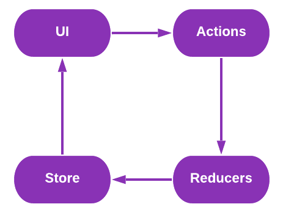
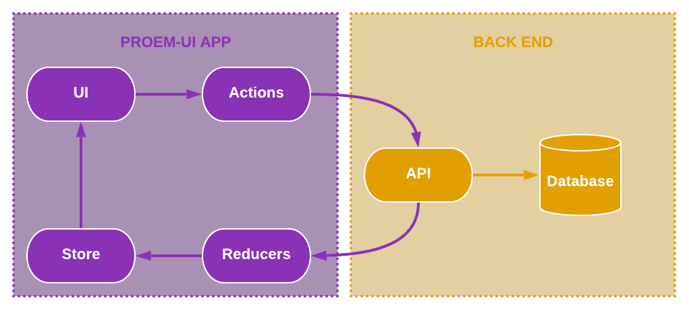

## Overview

Proem-UI uses [Redux](https://redux.js.org/) for centralized state management with strict patterns that ensure consistency, maintainability, and seamless integration with Parse Platform. This guide covers the Redux patterns, coding standards, and best practices used throughout the framework.

## Core Principle: Unidirectional Data Flow

The flow of information in a Proem-UI app follows a single direction:



Here, the UI invokes an action, which triggers a reducer, which updates the data store, which updates the UI. While this may seem like extra work initially, making data flow in a single direction makes debugging far easier and vastly improves scalability.

When working with backend systems, this flow becomes even more powerful:



> **New to React and Redux?** We recommend watching [LearnCode.academy](https://twitter.com/learncodeacad)'s tutorial series on [React JS](https://youtu.be/MhkGQAoc7bc?list=PLoYCgNOIyGABj2GQSlDRjgvXtqfDxKm5b) and [Redux](https://youtu.be/1w-oQ-i1XB8?list=PLoYCgNOIyGABj2GQSlDRjgvXtqfDxKm5b) for a solid foundation.

## File Structure and Naming

Store files should be named after their domain (e.g., `workspace.js`, `project.js`, `organizations.js`) and placed in the `src/store` directory.

All store files must follow this export pattern:

```javascript
// Named exports for actions and selectors
export const actions = { /* ... */ };
export const selectors = { /* ... */ };

// Reducer as default export
export default reducer;
```

## Core Principles

### 1. Action Type Constants

Always define constants for action types to prevent typos and mismatches:

```javascript
// Action type constants
const LIST = 'LIST_ORGANIZATIONS';
const ADD = 'ADD_ORGANIZATION';
const UPDATE = 'UPDATE_ORGANIZATION';
const DELETE = 'DELETE_ORGANIZATION';
const SET = 'SET_ORGANIZATION';
```

### 2. Domain Objects in State

All objects in the Redux store must be [domain objects](/docs/domain) that extend `BasicDomain` or `BasicArray`. This is critical for Parse integration and React change detection.

```javascript
// Initial state always uses domain objects
const initialState = {
    list: {
        data: new OrganizationArray(), // Domain array, not plain []
        isLoading: false,
        isLoaded: false,
    },
    selected: null, // Will be Organization domain object when set
    error: null,
};
```

For details on domain objects and their methods, see the [Domain Objects](/docs/domain) documentation

## Standard Reducer Template

Every reducer file should follow this complete example:

```javascript
import { createSelector } from '@reduxjs/toolkit';
import { Parse } from '../utils/parseProvider';
import { Organization, OrganizationArray } from '../../domain';

// Action type constants
const LIST = 'LIST_ORGANIZATIONS';
const ADD = 'ADD_ORGANIZATION';
const UPDATE = 'UPDATE_ORGANIZATION';
const DELETE = 'DELETE_ORGANIZATION';
const SET = 'SET_ORGANIZATION';

const initialState = {
    list: {
        data: new OrganizationArray(),
        isLoading: false,
        isLoaded: false,
    },
    selected: null,
    error: null,
};

export function reducer(state = initialState, action) {
    const { type, payload, meta } = action;

    switch (type) {
        case 'LOGOUT_USER_PENDING': {
            return initialState;
        }

        case `${LIST}_PENDING`: {
            return {
                ...state,
                list: {
                    ...state.list,
                    isLoading: true,
                },
                error: null,
            };
        }

        case `${LIST}_FULFILLED`: {
            return {
                ...state,
                list: {
                    data: new OrganizationArray(payload),
                    isLoading: false,
                    isLoaded: true,
                },
                error: null,
            };
        }

        case `${LIST}_REJECTED`: {
            return {
                ...state,
                list: {
                    data: new OrganizationArray(),
                    isLoading: false,
                    isLoaded: true,
                },
                error: payload?.message || 'Failed to fetch organizations',
            };
        }

        case `${ADD}_PENDING`:
        case `${UPDATE}_PENDING`:
        case `${DELETE}_PENDING`: {
            return {
                ...state,
                error: null,
            };
        }

        case `${ADD}_REJECTED`:
        case `${UPDATE}_REJECTED`: {
            return {
                ...state,
                error: payload?.message || 'Failed to create/update organization',
            };
        }

        case `${ADD}_FULFILLED`:
        case `${UPDATE}_FULFILLED`: {
            return {
                ...state,
                list: {
                    ...state.list,
                    data: state.list.data.clone().addUpdate(payload),
                },
                selected: payload.id ? payload.id : state.selected,
            };
        }

        case `${DELETE}_FULFILLED`: {
            return {
                ...state,
                list: {
                    ...state.list,
                    data: state.list.data.clone().remove(meta?.organization?.id),
                },
                selected: state.selected === meta?.organization?.id ? null : state.selected,
            };
        }

        case `${DELETE}_REJECTED`: {
            return {
                ...state,
                error: payload?.message || 'Failed to delete organization',
            };
        }

        case `${SET}_FULFILLED`: {
            return {
                ...state,
                selected: payload,
            };
        }

        default: {
            return state;
        }
    }
}

export const actions = {
    list: (status = Organization.STATUS_ACTIVE) => ({
        type: LIST,
        payload: new Parse.Query(Organization)
            .equalTo('status', status)
            .select(Organization.FIELDS)
            .findAll()
    }),
    create: (organization) => ({
        type: ADD,
        meta: { organization },
        payload: organization.save(),
    }),
    update: (organization) => ({
        type: UPDATE,
        meta: { organization },
        payload: organization.save(),
    }),
    remove: (organization) => ({
        type: DELETE,
        meta: { organization },
        payload: organization.destroy(),
    }),
    set: (id) => ({
        type: SET,
        meta: { id },
        payload: Promise.resolve(id),
    }),
}

export const selectors = {
    list: (state) => state.organizations.list.data,
    listMeta: createSelector(
        [(state) => state.organizations.list.isLoading, (state) => state.organizations.list.isLoaded],
        (isLoading, isLoaded) => ({
            isLoading,
            isLoaded,
        })
    ),
    current: createSelector(
        [(state) => state.organizations.list.data, (state) => state.organizations.selected],
        (organizationsData, selectedId) => {
            if (!selectedId) return null;
            return organizationsData.find(org => org.id === selectedId) || null;
        }
    ),
    currentId: (state) => state.organizations.selected,
    error: (state) => state.organizations.error,
}

export default reducer;
```

## Action Patterns

### Local Functions

For actions that resolve locally without API calls:

```javascript
export const actions = {
    clear: () => ({
        type: 'CLEAR_SOMETHING',
        payload: Promise.resolve(null)
    }),
    set: (id) => ({
        type: SET,
        meta: { id },
        payload: Promise.resolve(id),
    }),
};
```

### Parse Query Actions

Prefer Parse Queries over cloud functions when possible:

```javascript
export const actions = {
    // Get single record
    get: (id) => ({
        type: 'GET_CAR',
        meta: { id },
        payload: new Parse.Query(Car)
            .select(Car.FIELDS)
            .get(id),
    }),

    // List multiple records
    list: (skip = 0, limit = 50) => ({
        type: 'LIST_CARS',
        meta: { skip, limit },
        payload: new Parse.Query(Car)
            .skip(skip)
            .limit(limit)
            .select(Car.FIELDS)
            .find(),
    }),

    // Save single record (create or update)
    save: (car) => ({
        type: 'SAVE_CAR',
        meta: { car },
        payload: car.save(),
    }),

    // Save multiple records
    saveAll: (cars) => ({
        type: 'SAVE_ALL_CARS',
        meta: { cars },
        payload: Parse.Object.saveAll(cars),
    }),

    // Delete record
    remove: (car) => ({
        type: 'DELETE_CAR',
        meta: { car },
        payload: car.destroy(),
    }),
};
```

### Parse Cloud Functions

For complex operations requiring server-side logic:

```javascript
export const actions = {
    sendCarNotice: (car) => ({
        type: 'SEND_CAR_NOTICE',
        meta: { car },
        payload: Parse.Cloud.run('sendCarNotice', { car: car.toJSON() }),
    }),
};
```

## Important Rules

### DO:
- **ALWAYS** return a Promise as the payload
- Pass all parameters to `meta` for debugging
- Use `select()` with specific fields for performance
- Convert Parse Objects to JSON when passing to Cloud functions
- Use shorter action names (`get` not `getOrganization`)
- Use template literals for async action states (`${LIST}_PENDING`)

### DON'T:
- Never use `await` inside action creators
- Never use async functions in the payload
- Never store plain JavaScript objects - always use domain objects
- Never manually construct arrays - use domain array classes

**WRONG:**
```javascript
export const list = () => ({
    type: 'FETCH_ORGANIZATIONS',
    payload: (async () => {  // DON'T use async
        const orgs = await new Parse.Query(Organization).find();  // DON'T await
        return new OrganizationArray(orgs);  // DON'T transform
    })(),
});
```

**CORRECT:**
```javascript
export const list = () => ({
    type: 'FETCH_ORGANIZATIONS',
    payload: new Parse.Query(Organization)
        .select(Organization.FIELDS)
        .find()  // Returns Promise directly
});
```

## Using Redux in React Components

### With Modern React Hooks

```javascript
import { useDispatch, useSelector } from 'react-redux';
import { actions, selectors } from '../store/organizations';
import { useEffect } from 'react';

function OrganizationList() {
    const dispatch = useDispatch();
    const organizations = useSelector(selectors.list);
    const { isLoading, isLoaded } = useSelector(selectors.listMeta);
    const currentOrg = useSelector(selectors.current);
    const error = useSelector(selectors.error);

    // Fetch organizations on mount
    useEffect(() => {
        dispatch(actions.list());
    }, [dispatch]);

    // Select an organization
    const handleSelect = (orgId) => {
        dispatch(actions.set(orgId));
    };

    // Create new organization
    const handleCreate = (orgData) => {
        const newOrg = new Organization(orgData);
        dispatch(actions.create(newOrg));
    };

    // Update organization
    const handleUpdate = (org) => {
        org.set('name', 'New Name');
        dispatch(actions.update(org));
    };

    // Delete organization
    const handleDelete = (org) => {
        dispatch(actions.remove(org));
    };

    if (isLoading) return <Spinner />;
    if (error) return <Error message={error} />;

    return (
        <div>
            {organizations.map(org => (
                <OrganizationCard
                    key={org.id}
                    organization={org}
                    isSelected={org.id === currentOrg?.id}
                    onSelect={() => handleSelect(org.id)}
                    onUpdate={() => handleUpdate(org)}
                    onDelete={() => handleDelete(org)}
                />
            ))}
        </div>
    );
}
```

### Working with BasicArray

```javascript
import { useDispatch, useSelector } from 'react-redux';
import { actions, selectors } from '../store/users';

function UserProfile({ userId }) {
    const dispatch = useDispatch();
    const users = useSelector(selectors.list);
    const user = users.get(userId);  // Using BasicArray's get method

    const handleSave = () => {
        user.set('firstName', 'John');
        user.set('lastName', 'Doe');
        dispatch(actions.update(user));
    };

    return (
        <form onSubmit={handleSave}>
            {/* Form fields */}
        </form>
    );
}
```

## Middleware Requirements

This pattern uses `redux-promise-middleware` which automatically appends:
- `_PENDING` when the promise is initiated
- `_FULFILLED` when the promise resolves successfully
- `_REJECTED` when the promise fails

Configure in your store setup:
```javascript
import promiseMiddleware from 'redux-promise-middleware';

const store = configureStore({
    reducer: rootReducer,
    middleware: [promiseMiddleware],
});
```

## Learning Resources

**Redux:**
- [Redux Documentation](https://redux.js.org/)
- [Redux Tutorial by LearnCode.academy](https://youtu.be/1w-oQ-i1XB8?list=PLoYCgNOIyGABj2GQSlDRjgvXtqfDxKm5b) - Comprehensive video series covering Redux fundamentals

**React & Modern JavaScript:**
- [React Documentation](https://react.dev/)
- [JavaScript.info](https://javascript.info/) - In-depth JavaScript guide
- [React JS Tutorial by LearnCode.academy](https://youtu.be/MhkGQAoc7bc?list=PLoYCgNOIyGABj2GQSlDRjgvXtqfDxKm5b) - 14 videos on React & Flux

**Parse Platform:**
- [Parse Platform Documentation](https://docs.parseplatform.org/)
- [Parse JavaScript SDK Guide](https://docs.parseplatform.org/js/guide/)
